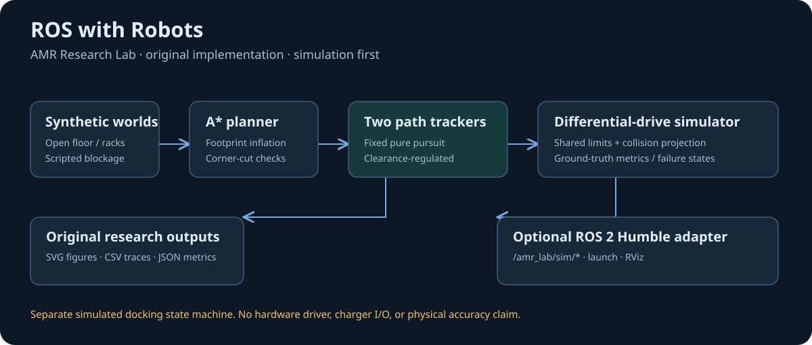
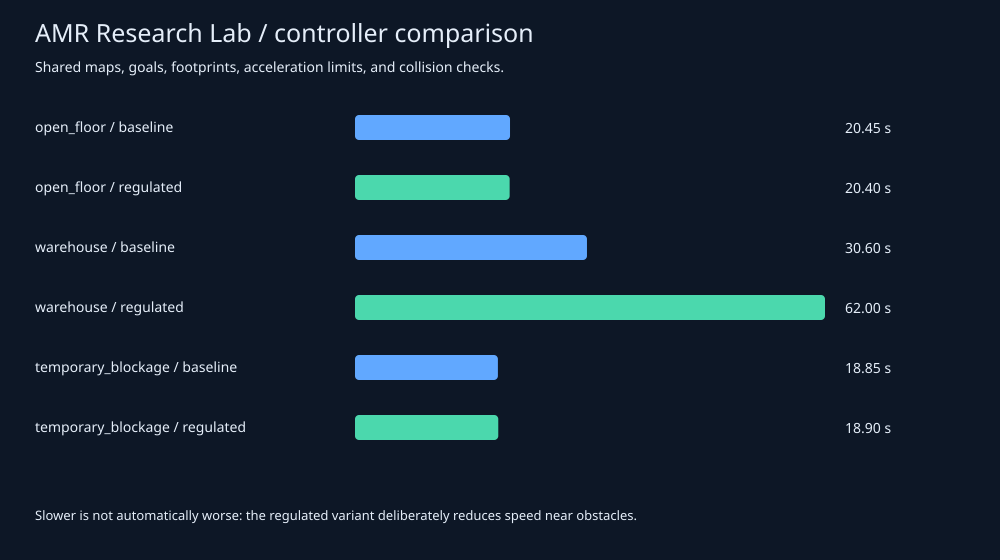

# ROS with Robots · AMR Research Lab

An original, simulation-first playground for differential-drive AMR planning,
path tracking, obstacle waiting, and docking-state experiments.



**Run the offline experiments with Python 3.10+ and no ROS installation.**
The optional adapter targets ROS 2 Humble on Ubuntu 22.04. This project is
educational research software; it does not include a hardware driver.

## Run in one minute

```bash
git clone https://github.com/Hareespandy-N/ROS-with-robots.git
cd ROS-with-robots
python -m amr_research_lab run --scenario warehouse --controller regulated --output results
python -m amr_research_lab benchmark --output results
python -m amr_research_lab dock
python -m unittest discover -s tests -v
```

On Linux, use `python3` if that is your Python executable. Open the generated
SVG files in a browser and the CSV/JSON files in your analysis tools.
The CLI returns a nonzero exit code if a navigation experiment fails.

## What is implemented

- Eight-neighbour A* with circular-footprint inflation and diagonal corner checks.
- A fixed-lookahead pure-pursuit baseline and an independently written,
  educational clearance/curvature-regulated tracker.
- Shared speed and acceleration limits, conservative sampled collision
  projection, goal-heading control, and an ideal differential-drive simulator.
- Three deterministic cases: open floor, warehouse racks, temporary blockage.
- A separate ALIGN → APPROACH → SETTLE → DOCKED state machine, with a FAILED
  terminal state. It performs simulated pose alignment, without charge I/O.
- Original SVG diagrams/plots, CSV traces, JSON metrics, and comparison tables.
- A ROS 2 simulation node, launch file, RViz configuration, and software CI.



The [checked-in results](examples/results/README.md) expose tradeoffs rather
than claiming that one controller always wins. Both use the same maps,
starts/goals, footprints, planner margin, collision checks, and rate limits.
This is not a comparison against the Nav2 implementation.

## ROS 2 Humble

In a separate Ubuntu 22.04 environment with ROS 2 Humble installed:

```bash
mkdir -p amr_lab_ws/src
cd amr_lab_ws/src
git clone https://github.com/Hareespandy-N/ROS-with-robots.git
cd ..
source /opt/ros/humble/setup.bash
rosdep install --from-paths src --ignore-src -r -y
colcon build --packages-select amr_research_lab
source install/setup.bash
export ROS_DOMAIN_ID=47
export ROS_LOCALHOST_ONLY=1
ros2 launch amr_research_lab simulation.launch.py scenario:=warehouse controller:=regulated
```

In another terminal with the same sourced environment and domain settings:

```bash
rviz2 -d src/ROS-with-robots/config/simulation.rviz
```

Install RViz separately if your ROS installation does not contain it. All
four application topics are under `/amr_lab/sim/`: `odom`, `planned_path`,
`cmd_vel`, and `obstacles`. Frames are `amr_lab/map` and `amr_lab/base_link`.
The adapter publishes the internal simulation state; it neither consumes
real odometry nor sends commands to a hardware driver. Do not remap this
educational velocity topic to a robot. No TF broadcaster is needed for the
provided fixed-frame RViz displays.

For a bounded node smoke run:

```bash
ros2 run amr_research_lab sim_node --ros-args -p max_steps:=80
```

## Research, attribution, and reuse

The five supplied papers inform the architecture and experiment questions.
The controller is inspired by the concepts in
[Regulated Pure Pursuit](https://arxiv.org/abs/2305.20026), with deliberately
simplified, separately authored heuristics. It is not an exact reproduction.
The [research notes](docs/RESEARCH.md) map each paper to this project's work
and clearly identify background-only topics.

All project code, prose, maps, and SVG figures were newly authored for this
repository. No paper PDFs, paper figures, upstream screenshots, or upstream
implementation files are bundled. [MIT](LICENSE) covers this project's
authored material. External references keep their own rights and licenses;
see [provenance and reuse notes](docs/PROVENANCE.md).

## What the measurements mean

Results use ideal numerical ground truth, in metres/radians, with no sensor
noise, wheel slip, actuator latency, payload dynamics, or localization error.
`final_xy_error_m` is the Euclidean distance between the requested goal and
the simulated final pose. `final_yaw_error_rad` is the wrapped heading error.
`min_clearance_m` is the minimum sampled distance from the disk footprint to
an obstacle or world boundary. `blocked_time_s` counts steps where prediction
requested braking. A collision terminates the numerical experiment as a
failure; it is not reported as a successful emergency stop.

Small simulated errors do not establish real-robot accuracy. Physical
**+/-1 mm positioning is not proven yet**; calibrated independent metrology,
real sensors/hardware, and repeated representative trials would be required.
The software checks here do not replace machine protective functions.

## Verification and project map

Local verification used Windows / Python 3.12.10. The offline suite, six
benchmarks, syntax checks, and package metadata checks were executed. The
ROS smoke test is explicitly skipped when `rclpy` is absent. Linux CI is
defined for Python 3.10/3.12 and a real ROS Humble container; consult the
[Actions results](https://github.com/Hareespandy-N/ROS-with-robots/actions)
for observed runs rather than assuming a workflow file proves success.

| Location | Purpose |
|---|---|
| `amr_research_lab/navigation.py` | Geometry, collision geometry, A* |
| `amr_research_lab/simulation.py` | Controllers, limits, scenarios, metrics |
| `amr_research_lab/docking.py` | Simulated docking state machine |
| `amr_research_lab/reporting.py` | Original SVG/CSV/JSON reporting |
| `amr_research_lab/ros_node.py` | Simulation-only ROS adapter |
| `tests/` | Behavioral and real-ROS smoke checks |
| `examples/results/` | Reproducible simulation outputs |
| `docs/` | Research, provenance, design, and Tamil quick start |

[தமிழ் quick start](docs/QUICKSTART_TA.md) · [Research references](docs/RESEARCH.md)
